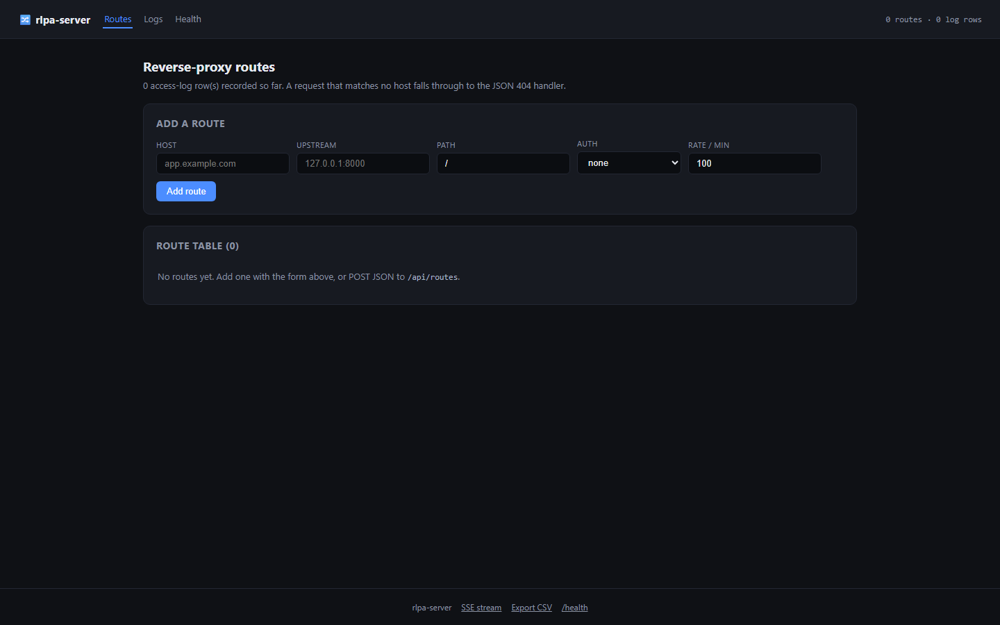
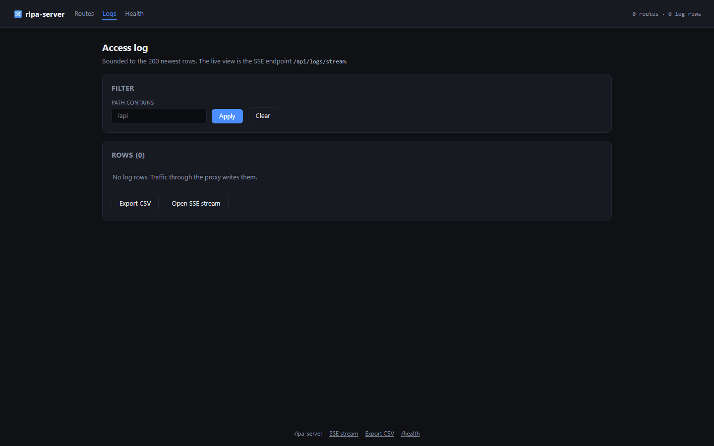
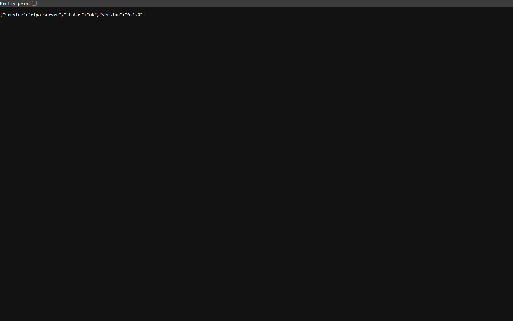
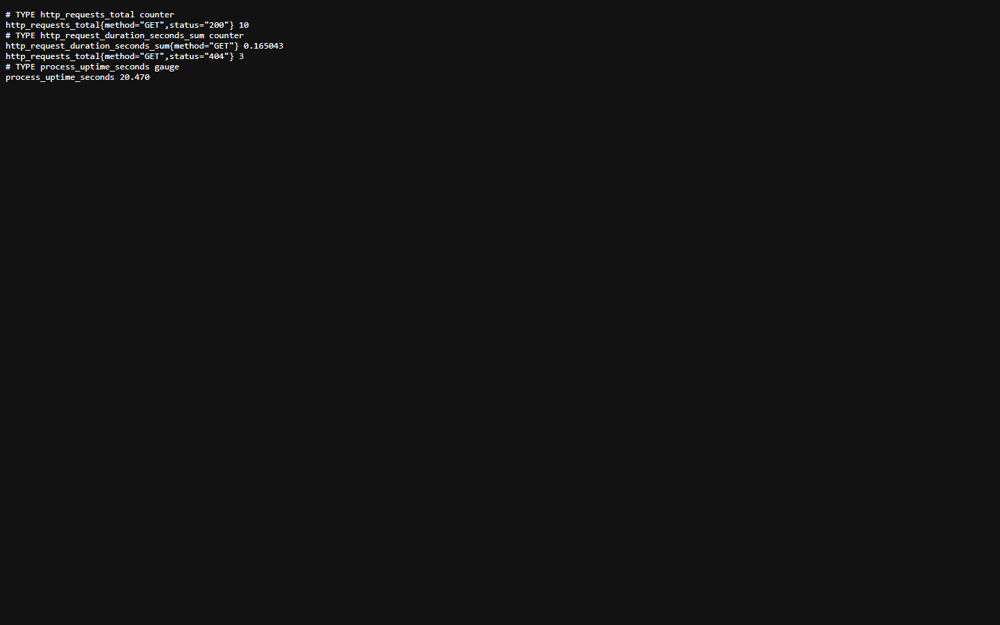
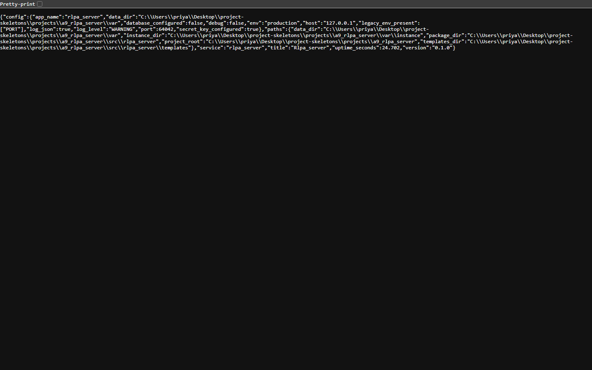

<p align="center">
  
</p>

<h1 align="center">backlane</h1>

<p align="center"><b>A reverse proxy with per-route auth and a log you can stream.</b></p>

<p align="center">
  <a href="#quality-gates"></a> <a href="#quality-gates"></a> <a href="#api"></a> <a href="#requirements"></a> <a href="LICENSE"></a>
</p>

backlane terminates HTTP, authenticates the caller, forwards to an upstream and records the exchange. Routes are rows: host, path prefix, upstream, auth requirement. Access logs are queryable as JSON, streamable as SSE and exportable as CSV.

---

**Contents** &nbsp;·&nbsp; [Why](#why-this-exists) &nbsp;·&nbsp; [What it does](#what-it-does) &nbsp;·&nbsp; [Quickstart](#quickstart) &nbsp;·&nbsp; [API](#api) &nbsp;·&nbsp; [Screenshots](#screenshots) &nbsp;·&nbsp; [Measured](#measured-not-estimated) &nbsp;·&nbsp; [Architecture](#architecture) &nbsp;·&nbsp; [Quality gates](#quality-gates) &nbsp;·&nbsp; [Deploy](#deploy) &nbsp;·&nbsp; [Limits](#limits-stated-rather-than-hidden)

## Why this exists

nginx does this in configuration files that only one person understands and cannot query. Making routes data means adding a backend is an API call, and making the log queryable means an incident review is a filter rather than a grep over rotated files.

## What it does

| Capability | How it works |
| --- | --- |
| **Data-driven routes** | Add, list and delete routes at runtime; the catch-all resolves host and path against the table. |
| **Per-route auth** | A route can require a token; unauthorised requests are logged and refused before the upstream is touched. |
| **Access log as data** | Structured rows with status, latency and upstream, plus CSV export for a spreadsheet. |
| **Live log stream** | GET /api/logs/stream pushes new entries as SSE, so a dashboard does not poll. |

## Quickstart

```sh
git clone https://github.com/scar8969/backlane.git
cd backlane
python -m venv .venv && . .venv/bin/activate   # Windows: .venv\Scripts\activate
pip install -e ".[dev]"
python wsgi.py                                 # http://127.0.0.1:8000
```

The same work from the CLI:

```sh
python -m rlpa_server.cli --help
```

Commands: `route`, `add`.

A first request:

```sh
curl -s http://127.0.0.1:8000/api/routes | head
```

## Requirements

- Python **3.11+** — CI runs 3.11, 3.12 and 3.13.
- Runtime dependencies: `Flask>=3.0`, `Flask-SQLAlchemy>=3.1`, `SQLAlchemy>=2.0`, `PyYAML>=6.0`, `httpx`.
- No JavaScript build step: every page is server-rendered Jinja.

## API

Every route below is in [`openapi/backlane.yaml`](openapi/backlane.yaml) and is exercised by the live probe recorded in [`docs/EVIDENCE.md`](docs/EVIDENCE.md).

| Method | Path | What it does |
| --- | --- | --- |
| `GET` | `/api/routes` | list |
| `POST` | `/api/routes` | add route |
| `DELETE` | `/api/routes/<id>` | delete |
| `GET` | `/api/logs` | logs |
| `GET` | `/api/logs/stream` | SSE |
| `GET` | `/api/logs/export` | CSV |

## Screenshots

Captured from the running service with headless Chromium at 1440×900, one image per page, committed under [`docs/assets/screens/`](docs/assets/screens/).

<table>
<tr>
<td width="50%"><br><sub><code>/logs</code> &middot; 26.2 KB</sub></td>
<td width="50%"><br><sub><code>/healthz</code> &middot; 8.2 KB</sub></td>
</tr>
</table>

<table>
<tr>
<td width="50%"><br><sub><code>/livez</code> &middot; 7.3 KB</sub></td>
<td width="50%"><br><sub><code>/metrics</code> &middot; 14.9 KB</sub></td>
</tr>
</table>

<table>
<tr>
<td width="50%"><br><sub><code>/readyz</code> &middot; 7.7 KB</sub></td>
<td width="50%"><br><sub><code>/version</code> &middot; 25.6 KB</sub></td>
</tr>
</table>

## Measured, not estimated

These numbers were produced on this checkout by `pytest --cov` and by booting `wsgi.py` and issuing one real GET per documented path. The commands are in [`docs/EVIDENCE.md`](docs/EVIDENCE.md).

| Signal | Value |
| --- | --- |
| Tests | **23 / 23 passed** (2.3 s, exit 0) |
| Line coverage | **68.1%** — 448 of 628 statements |
| Source | 16 files / 1,430 lines |
| Test code | 4 files / 227 lines |
| Documented paths | 5 in the spec, 4 GET |
| Live probe | 13 GET requests to the booted app, **12 answered 200** |
| Median latency | **24.9 ms** (single uncached request, dev server) |
| Slowest / fastest | 10056.5 ms `/api/logs/stream` / 3.6 ms `/healthz` |
| Bytes served | 10.8 KB across 13 responses |
| Screenshots | 7 captured |

## Architecture

```
backlane/
├── src/rlpa_server/
│   ├── http.py                         379  HTTP plumbing for rlpa_server: correlation ids, acce
│   ├── proxy/api.py                    172  
│   ├── config.py                       171  Environment-driven configuration for rlpa_server
│   ├── observability.py                169  Structured logging and request correlation for rlpa_
│   ├── _app.py                         126  
│   ├── app.py                          119  Application factory for rlpa_server
│   ├── errors.py                       108  Typed application errors and their HTTP mapping for 
│   ├── paths.py                         52  Filesystem layout for rlpa_server
│   ├── models.py                        40  
│   ├── cli.py                           31  
│   ├── proxy/router.py                  24  
│   ├── proxy/ratelimit.py               19  
├── openapi/backlane.yaml                  the contract of record
├── schema/backlane.sql                    the DDL
├── tests/                       the suite that has to stay green
├── docs/EVIDENCE.md             the recorded live route walk
├── Dockerfile                   multi-stage build
└── wsgi.py                      entry point
```

The package keeps one shape across the service: `config.py` reads the environment once, `observability.py` emits structured JSON logs carrying a request id, `errors.py` turns exceptions into a single JSON envelope, `models.py` holds the tables, and the `proxy/` package holds the routes.

## Quality gates

| Gate | Command | Threshold |
| --- | --- | --- |
| Suite | `pytest -q` | all green |
| Coverage | `pytest --cov` | floor set in `pyproject.toml` from the measured value |
| Lint | `ruff check src tests` | zero findings |
| Format | `ruff format --check src tests` | zero reformats |
| Types | `mypy src` | zero errors |
| Security | `bandit -c pyproject.toml -r src` | reviewed skip list, no unreviewed finding |
| Live routes | boot `wsgi.py`, one GET per documented path | no 5xx, no undocumented guard |

CI runs the first six on Python 3.11, 3.12 and 3.13 for every push to `main`, plus a container build. See [`.github/workflows/ci.yml`](.github/workflows/ci.yml).

## Deploy

```sh
docker build -t backlane .
docker run --rm -p 8000:8000 --env-file .env.example backlane
```

Configuration is environment-only — every variable is documented in [`.env.example`](.env.example), and the service refuses to start with a production secret missing.

## Limits, stated rather than hidden

- HTTP/1.1 forwarding only; WebSocket upgrade is not proxied in this release.
- The proxy is a single process — horizontal scaling needs a shared database and sticky routing.

## License

MIT — see [LICENSE](LICENSE).
